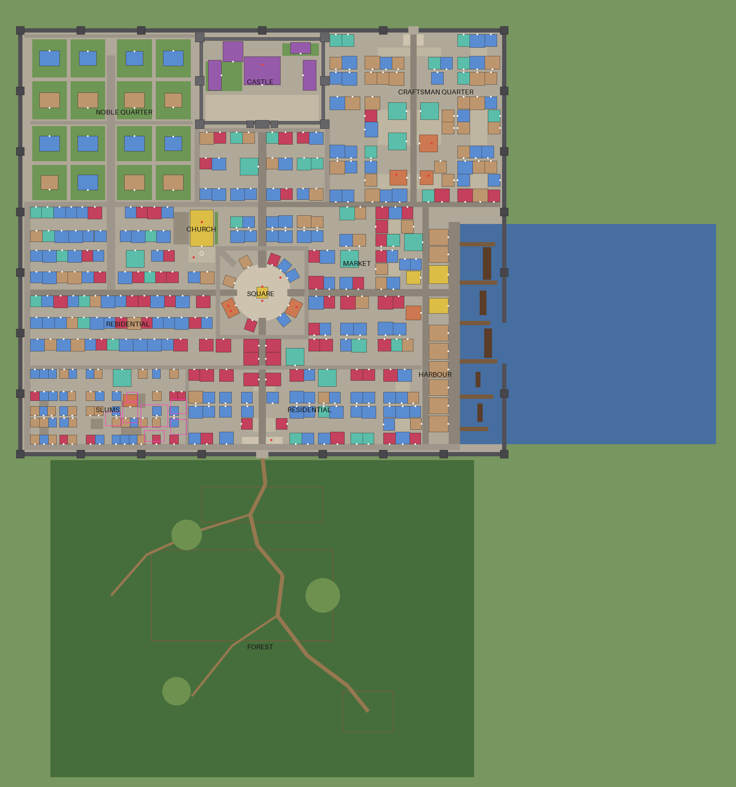

# The capital

The capital of House Lundand, its forest and the thieves' hideout are generated from data when a server starts.
`ServerStorage/ServerData/CityLayout` holds the plan. `ServerScriptService/Server/Tools/CityBuilder` turns it into
parts. `Server/Domain/LayoutRules` checks the plan without Studio.



The plan above is drawn by `tools/render_plan.py`. North is up, the forest lies beyond the south gate and the harbour
opens to the sea in the east. Each white dot marks a door.

| Colour | Meaning |
| --- | --- |
| blue | Home for sale: a player can buy it |
| rose | Player shop for sale, with its counter on the street |
| tan | House or building that isn't for sale |
| orange | Public building you walk into (guild, inns and taverns, forge, apothecary) |
| gold | Public landmark (church, the Heart of Realms, customs house, fish market) |
| purple | Castle |
| teal | Guild hall |
| dark grey | City and castle walls, towers and gatehouses |
| red dots | NPCs |
| magenta outlines | Hideout rooms, underground |

## Scale

| | |
| --- | --- |
| Walls | 960 x 840 studs, 30 high, with 25 towers (16 studs square) about every 120 studs |
| Gates | South gate to the forest, north gate to the mountain road, sea gate into the harbour |
| Streets | Main roads 12 to 16 studs, side streets 6 to 8, alleys 4 to 5 |
| Houses | 356, each 16 to 40 studs wide, one to three storeys, built from 15 house models (68 of them are shops) |
| For sale | 172 homes, 74 shops and 42 guild halls and guild houses: 288 property IDs |
| Public buildings you walk into | 17 (10 of them guild halls), plus the church, the keep, the Royal Library and the fish market |
| Parts | About 14,000, of which 104 cast light |

## How the buildings work

Most buildings are closed shells: walls, windows, a roof and a door. The door leads to an instanced interior, a
room far above the map. Only the few public buildings have a real ground floor you walk into.

- **House models.** Each district has two or three house models. `ServerStorage.CityAssets.Houses` holds one copy of
  each. Every house in the city is a clone, painted in its district's colours. Change a model there in Studio and
  every house built from it follows. A house model needs a part named `Door`.
- **Interiors.** `ServerStorage.CityAssets.Interiors` holds one room per house model (and one per inn). For now a
  room is only its walls: floor, ceiling, four walls, a lamp and the door back out. A room needs a part named `Entry`
  (where you appear) and one named `ExitDoor`.
- **Going in.** The door's Enter prompt asks `InteriorService` for the house's room. The room is cloned into a free
  slot in a grid above the map only when someone goes in. Everyone in the same house shares that room. When the last
  person leaves, the room is removed after 30 seconds.
- **Going out.** The Leave prompt on the room's door puts you back in the street in front of the house. Anyone who
  dies, resets or leaves the game is no longer counted as inside.

| District | House models (facade x depth, storeys) |
| --- | --- |
| Merchant Square and the market streets | MarketA 22 x 24, MarketB 26 x 24, MarketC 30 x 26, all 3; the ring around the square uses RingHouse 20 x 22, 3 |
| Old Town | TownA 22 x 22, 2; TownB 24 x 22, 3; TownC 28 x 24, 2 |
| Craftsman quarter | CraftA 24 x 24, 2; CraftB 30 x 26, 2 |
| Harbour | HarborA 22 x 22, 2; HarborB 28 x 24, 3 |
| Slums | SlumA 16 x 18, 1; SlumB 18 x 18, 2 |
| Noble quarter | Mansion 40 x 30, 3; Manor 34 x 28, 2 |

## Districts

- **Merchant Square**: a paved disc 112 studs across with the Heart of Realms at its centre: the crystal the whole story turns on, floating over a stepped dais ringed by obelisks. A
  ring of three-storey houses and shops surrounds it, with the Adventurers' Guild and the Square Inn facing it.
  Market streets lined with shops run east and south of it.
- **Church**: north-west of the square, reached by a lane from the plaza. It has a nave with pews facing the altar,
  aisles, stained glass, a bell tower, a sacristy and a side chapel. The awakening circle is set into the nave floor;
  new characters appear in the aisle beside it.
- **Castle**: north. Curtain walls and towers enclose a courtyard. Inside are the keep (throne hall), the Royal
  Library (a double-height reading hall with a gallery), the barracks, the chancery, the servants' hall and the royal
  gardens. House Lundand's crest (a silver tower under a gold rift-star on deep blue) appears on banners, gates and
  the throne hall.
- **Noble quarter**: north-west. Sixteen walled estates with gardens line the noble avenue; nine are for sale.
- **Old Town**: west and south. Rows of townhouses on streets and lanes, with shops along the busier streets.
- **Craftsman quarter**: north-east, along the north gate road. The City Forge, the apothecary, the Craftsmen's
  Guild, three guild halls, and craftsmen's houses and shops.
- **Harbour**: east. A quay with cranes and cargo, six piers, five ships, warehouses, the customs house, the fish
  market, the Salt and Anchor tavern and the cargo office.
- **Slums**: south-west, against the wall. Small, low, weathered houses on narrow alleys, with laundry lines and a
  well. The Crooked Lantern tavern hides the way down to the hideout.

## Shops

The economy is run by players. Only two NPCs sell anything, and only what a new character needs to start: the Forge
Master (copper tools and a starter sword) and the Apothecary (minor health potions). The market stalls are
decoration. Everything else is bought and sold in player shops.

- **Where.** 74 shops stand on streets all over town: round the square, along the main roads and the market street,
  in Old Town, the craftsman quarter and the slums. Every street spot has a foot-traffic score, from 0 for a quiet
  back lane far from the square to 1 for a main road by the square. The busier the spot, the likelier a house there is
  a shop. A shop needs 7 studs of clear street in front of it for its counter; `LayoutRules` checks this.
- **The counter.** Each shop has a counter on the street beside its door, under an awning, with a hanging sign. At an
  owned shop the counter opens the shop window (`ShopService`): customers buy listings and sell into buy orders, and
  the owner lists goods and collects earnings. At a shop for sale it opens the deed, to buy it. The counter's prompt and
  the sign show the owner's name.
- **The door.** A shop's door leads to its own room, like a house's: the owner's back room, empty for now.
- **One each.** A player may own one shop and one home.

## Guild halls

42 guild buildings stand around town, fewer than the shops. Ten are big guild halls: three in the craftsman quarter,
two by the square, three in Old Town, one at the harbour and one in the slums. The other 32 are guild houses, smaller
halls on ordinary streets (cheaper, from 80,000 gold before location). A guild's leader buys one from the guild treasury once the guild reaches level 5, and
each guild may have one. A hall's ground floor is a room you walk into, with the guild's planning table in it.

## What things cost

A property's price is its tier's price times a factor set by its spot's foot traffic (`Domain.PropertyPricing`, with
the ranges in `Config/PropertyRules`). Shops feel their spot most, because they live off passers-by; homes feel it
least. The window that opens at a deed or a counter shows how busy the spot is.

| Kind | Factor range | Prices now |
| --- | --- | --- |
| Shop | 0.5 to 2.5 times 100,000 | 50,000 in a back lane to 236,000 on the square |
| Guild hall | 0.8 to 1.6 times 150,000 | 155,000 to 203,000 |
| Home | 0.85 to 1.25 times the tier (25,000, 60,000 or 250,000) | slum houses 21,500 to 27,000, town houses 51,000 to 73,500, mansions about 213,000 |

All prices are placeholders.

## Owning a home

- **Buying.** Walk up to the deed plaque beside a house's door (or a shop's counter) to see its price and buy it. The purchase uses the
  four-step protocol in `PropertyOwnership`: reserve, charge, commit, record. It is server-checked and safe across
  servers, and an interrupted purchase is settled on the buyer's next join. Each player may own one home and one shop.
- **One owner.** Each house has one property ID, so only one player can own it, on every server.
- **Visiting.** Going in never grants ownership. Anyone can look round a home nobody owns.
- **Privacy.** Once a home is owned, its door only lets in the people its owner allows. Owners choose Only me, My
  friends or Anyone in the property window. Anyone inside who is no longer allowed is shown out: at once when the
  owner changes it or the house is bought, and within a few seconds when that happens on another server.
- **What can't be bought.** Public buildings, the castle, the church, warehouses, the hideout and other story places
  carry no deed. `CityLayout.spec` checks this.

## Inn rooms

Every player can have somewhere to stay without buying a house. Each inn rents one kind of room, and any number of
players can rent it at once: each renter gets their own copy. Rooms are small, and get bigger and dearer with the inn.

| Inn | Where | Room (studs) | Gold per day |
| --- | --- | --- | --- |
| The Crooked Lantern | Slums | 10 x 12 | 10 |
| The Salt and Anchor | Harbour | 12 x 14 | 25 |
| The Square Inn | Merchant Square | 14 x 16 | 50 |

The Rooms door in the inn's back wall opens the rental window (at the Square Inn the innkeeper does too). You rent
at one inn at a time. Paying again there extends the stay, up to 7 days ahead. Gold is taken and the rental made in
one step, so you never pay without getting the room. While the rental runs, the window at the Rooms door has a
button that takes you up to your room. Prices are placeholders.

## The forest and the hideout

The forest (`CityBuilder/Forest`) starts at the south gate. A dirt road winds south past a shed and fields into
thickening woods. There are side paths, three clearings, low hills, rocks, roots, fallen logs, a ruined cabin, an
old watchtower and a forgotten shrine. The wolves' den is a ring of boulders around a cave mouth. The spawner and
gathering zones keep their IDs: `ForestEdge`, `ForestDeep` and `ForestDen`.

The hideout (`CityBuilder/Hideout`) is reached on foot. A trapdoor in the Crooked Lantern's back room leads down to
the cellar. Behind a wine rack swung aside, a landing and a long stair lead to the rooms below:

- the entrance
- the stolen-goods store
- the meeting hall
- the bunks
- the guarded inner room
- the leader's room

The spawner zones keep their IDs (`HideoutEntrance`, `HideoutHall`, `HideoutInner`, `HideoutThrone`).

## Running 50 to 200 players

- **Few parts.** Houses are closed shells of a few dozen parts each. Rooms exist only while someone is in them,
  so the city is about 14,000 parts.
- **Streaming.** The patched place turns on `Workspace.StreamingEnabled`, so each client loads only what is near
  it. Places, NPC anchors and markers live in a model set to stream as Persistent, so quest guidance and prompts
  always find them. Before moving you into or out of a room, the server asks the client to stream that spot in.
- **Lights.** 104 parts cast light: street lanterns, landmarks and one lamp per public building. Other lamps glow but
  cast no light.
- **No flicker.** `tools/inspect-city.luau` looks for faces of different parts that lie in the same plane and
  overlap, which flicker on screen. There are none.
- **Building time.** The city builds in a few seconds at server start, pausing between batches. The ground and the
  spawn point go in first.

To skip building at start, run the builder in Studio edit mode and save the place:

```lua
require(game.ServerScriptService.Server.Tools.CityBuilder).build()
```

## Changing the city

1. Edit `ServerStorage/ServerData/CityLayout`. That covers the house models, hand-placed landmarks, district grids
   (street lines and widths), how many homes are for sale, the forest and the hideout. To change how a house model
   looks, edit it in `ServerStorage.CityAssets.Houses` instead.
2. Run `lune run tools/check-layout.luau`. It reports:
   - overlapping buildings, and buildings in a wall tower
   - roads through buildings
   - doors that can't be reached from the gates
   - houses that don't match their house model
   - property or location IDs that are missing or placed twice
3. If the number of homes changed, update the counts in `ReplicatedStorage/Shared/Config/World`. The check above
   names the missing or unknown IDs.
4. Run `lune run tools/inspect-city.luau` and `lune run tools/run-tests.luau`. The inspection checks every door,
   room and inn, every public doorway, and flicker.
5. Look at it: `lune run tools/dump-layout.luau && python3 tools/render_plan.py` draws the plan.
   `tools/export-parts.luau` and `tools/render_view.py` draw a rough 3D view of an area or a single building.
